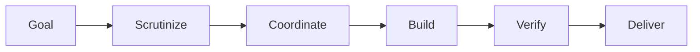

# AI Agent Team

`code-agent` is the shared home for specialist agent instructions, reusable skills, and coding standards for Claude Code and Codex. It is a set of guidance files, not an agent runtime or framework.

## What guides the team

- **Keep work simple.** Reuse what exists and choose the smallest design that solves the task.
- **Make code easy to follow.** Prefer clear, explicit steps over clever or compressed code.
- **Verify claims.** A handoff needs inspectable evidence; an agent saying “tests pass” is not proof.

See [AGENTS.md](AGENTS.md) for the full coding standards.

## Workflow at a glance

For non-trivial work, clarify the goal and scrutinize the plan before implementation. The Master chooses specialists and the review/QA depth needed; small, low-risk requests can take a shorter path. Every handoff records status, deliverables, evidence, verification, risks, and the recommended next step. Long-running tasks keep progress in `.agent-team/tasks/<task-id>.md`.



The legacy image at `assets/ai-agent-team-workflow.png` still lists seven roles and skills that are no longer in this repository, so it is not shown as the current workflow.

Parallel work uses distinct file ownership. After two unsuccessful correction cycles on the same gate, the team tests the shared assumption before trying again.

## Specialist agents

Claude definitions live in `agents/claude/`; Codex definitions live in `agents/codex/`. Keep each pair aligned.

| Agent | Owns |
|---|---|
| `backend` | APIs, databases, authentication, transactions, and server performance |
| `frontend` | UI behavior, client state, accessibility, and performance |
| `data_scientist` | AI/ML problem formulation, experiments, evaluation, and model serving |
| `debugger` | Root-cause analysis using the four-mantra protocol |
| `qa_tester` | Runtime verification, regression tests, and test strategy |
| `software_eng` | Architecture, interfaces, dependencies, and refactoring guidance |
| `code_reviewer` | Static code-quality review; read-only, with no command execution |
| `technical_researcher` | Technical literature discovery, mechanism analysis, source verification, and research synthesis |

The `code_reviewer` identifies source-level risks. `qa_tester` owns runtime proof. The debugger must reproduce, trace, falsify its hypothesis, and connect the evidence before proposing a fix.

## Skills

Each skill is in `skills/<name>/SKILL.md`.

| Skill | Use it for |
|---|---|
| `scrutinize` | Checking a requirement or plan before implementation |
| `frontend-design` | Choosing a distinct visual direction for UI work |
| `team-coordinate` | Coordinating multi-agent work and durable task checkpoints |
| `pdf` | Reading, creating, and manipulating PDFs |
| `report` | Writing evidence-backed technical or research reports |

## Use with other models and open-source harnesses

This repository separates reusable instructions from the software that runs agents. Skills are Markdown instruction bundles; the definitions in `agents/claude/` and `agents/codex/` use platform-specific formats and may need conversion for another harness.

You can use the skills with open-source harnesses such as [Qwen Code](https://github.com/QwenLM/qwen-code), [Pi](https://github.com/badlogic/pi-mono), [Oh My Pi](https://github.com/can1357/oh-my-pi), or [DeepSeek Harness](https://github.com/DeepSeek-ai/DeepSeek-Harness) when configured to discover Agent Skills. This repository keeps them in `skills/`; copy a skill to a location the harness scans, such as `.agents/skills/`, or configure its custom skill path.

Qwen, DeepSeek, GLM, and MiniMax are model or provider choices, while the harness supplies the tools and agent workflow. Select a provider supported by your harness; API compatibility and tool-calling behavior vary by provider and model. Claude or Codex subscriptions are not required when your chosen harness and provider use separate access credentials.

Skills provide instructions, but do not add runtime capabilities. Specialist delegation, parallel work, file isolation, hooks, and durable checkpoints depend on the harness and its available tools. Map the team roles to that harness's agents or subagents where needed.

## Install

### Claude Code

Install agents and skills globally:

```bash
mkdir -p ~/.claude/agents ~/.claude/skills
cp agents/claude/*.md ~/.claude/agents/
for skill in scrutinize frontend-design team-coordinate pdf report; do
  cp -R "skills/$skill" ~/.claude/skills/
done
```

For a single project, copy the skills you need into `/path/to/project/.claude/skills/` instead.

### Codex

Install agents and the skill currently marked compatible with Codex:

```bash
mkdir -p ~/.codex/agents ~/.codex/skills
cp agents/codex/*.toml ~/.codex/agents/
cp -R skills/team-coordinate ~/.codex/skills/
```

For a project-scoped skill install, use `/path/to/project/.agents/skills/`. Restart the client if it does not detect a newly installed skill.

## Repository standards

- Preserve all eight agent names and their domain boundaries. Edit Claude and Codex definitions as a pair.
- Keep one canonical directory per skill. A skill's `SKILL.md` must have `name` and `description` frontmatter.
- Before committing persona changes, run `python3 scripts/check_personas.py`. CI runs the same check on pushes and pull requests.
- Check third-party licenses and permission before redistributing skills. Keep required license files and attribution with vendored material.
- Do not add machine-specific settings, credentials, histories, or bundled system skills.

`AGENTS.md` is loaded automatically when Codex starts in this repository. In another repository, copy it only if no `AGENTS.md` exists; otherwise merge its implementation-style guidance into the existing file.

## Attribution and license notes

- `scrutinize` is adapted from [`9arm-skills — scrutinize`](https://github.com/thananon/9arm-skills/blob/1b222f2284eea323f542a43e891dc5250bffa15c/skills/engineering/scrutinize/SKILL.md) by [thananon](https://github.com/thananon). This version focuses on pre-implementation review and adds a simplification ladder, severity levels, and the team handoff contract.
- The debugger's four-mantra sequence is adapted from [`9arm-skills — debug-mantra`](https://github.com/thananon/9arm-skills/blob/d714cb84f35e0c42b2ca29bca505e564ab9f2bcd/skills/engineering/debug-mantra/SKILL.md) by thananon, with team-specific gates, evidence templates, and a fix protocol.
- The upstream `9arm-skills` repository does not show a license. Attribution does not grant redistribution rights; permission to distribute these adaptations has not been confirmed.
- `frontend-design` is vendored unchanged from [anthropics/skills](https://github.com/anthropics/skills) at commit `34040c9` under Apache 2.0; its `LICENSE.txt` is included.
- `pdf` came from a bundled Claude skill marked proprietary. Its referenced `LICENSE.txt` is missing; see the skill's frontmatter before redistributing it.
- Two engineering checks are adapted from [pstack](https://github.com/cursor/plugins/tree/main/pstack) (MIT, Lauren Tan, commit `519d36a`): testing the shared premise after repeated failed fixes and enforcing repeated rules with checks.

## Repository contents

This repository contains the user-owned skills and agent definitions collected from `~/.claude/`, `~/.codex/`, and `~/.agents/`. Bundled and package-managed skills remain with their owning products.
